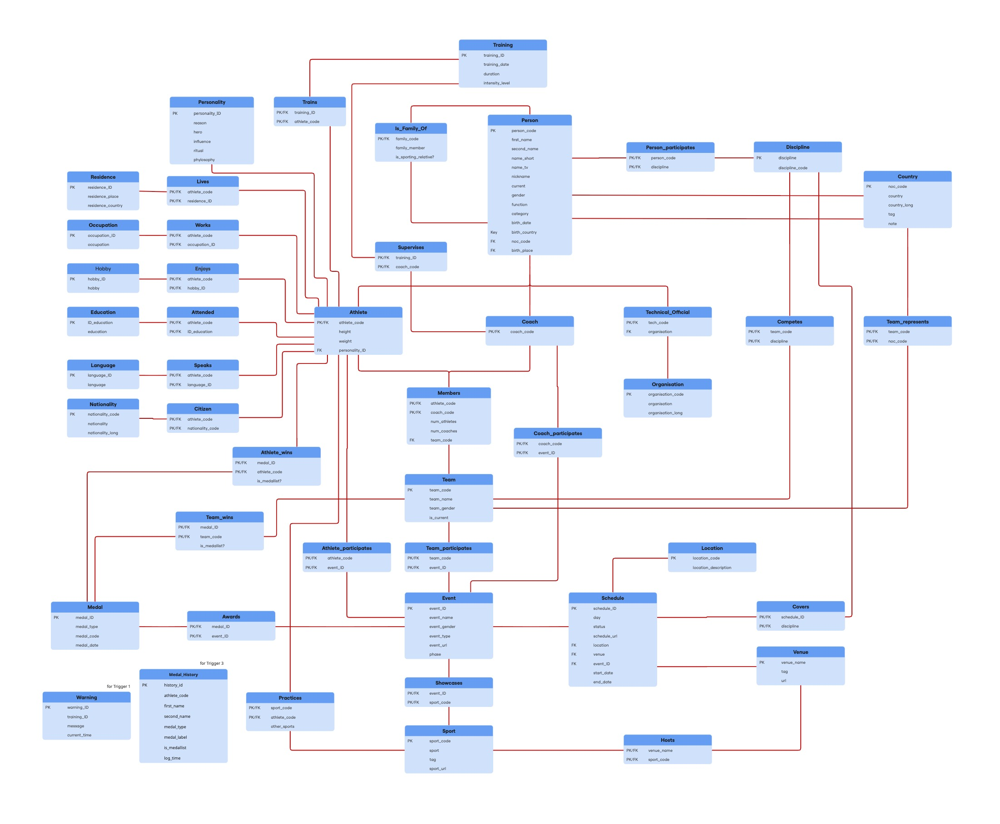

# Paris 2024 Olympics Database 🏅

A relational database of the **Paris 2024 Olympic Games**, built in **Oracle SQL**: from the entity-relationship model to 45 tables, data import, 30 analytical queries and 3 triggers.

Team project for the **Databases** course, Bachelor in Artificial Intelligence & Data Science, La Salle – Universitat Ramon Llull (2025–2026).

 



## What's inside

1. **Conceptual and relational models** of the Games: athletes, coaches, technical officials, teams, countries, sports, disciplines, events, venues, schedules and medals, plus personal details such as education, languages, hobbies and family links.
2. **Physical model:** 45 tables with primary keys, foreign keys and constraints.
3. **Data import:** the original Paris 2024 CSV files (athletes, coaches, technical officials, NOCs, events, venues, schedules, medals) loaded into staging tables and transformed into the final schema, with validation counts after each step.
4. **30 analytical queries**, for example:
   - Which countries won medals in all three categories (gold, silver and bronze)?
   - Which coaches are training athletes across more than one discipline?
   - Which countries sent many athletes but haven't won any medals?
   - Which venues hosted the most different events in a single day?
5. **3 triggers** that keep the data consistent automatically: flag training records with missing dates, update athletes' current training, and keep a medal history.

## Team

Alex Vilamitjana · Oriol Pros · Sara Gibert

## Files

```
sql/01_physical_model.sql          Creates the 45 tables
sql/02_import.sql                  Moves data from the CSV staging tables into the schema
sql/03_queries_and_triggers.sql    30 queries and 3 triggers
models/                            Conceptual and relational model diagrams
docs/report.pdf                    Full project report
docs/presentation.pdf              Final presentation slides
```

## Run it

1. Load the Paris 2024 CSV files into staging tables in an Oracle database (the report describes each file).
2. Run the scripts in order: `01_physical_model.sql`, `02_import.sql`, then `03_queries_and_triggers.sql`.
